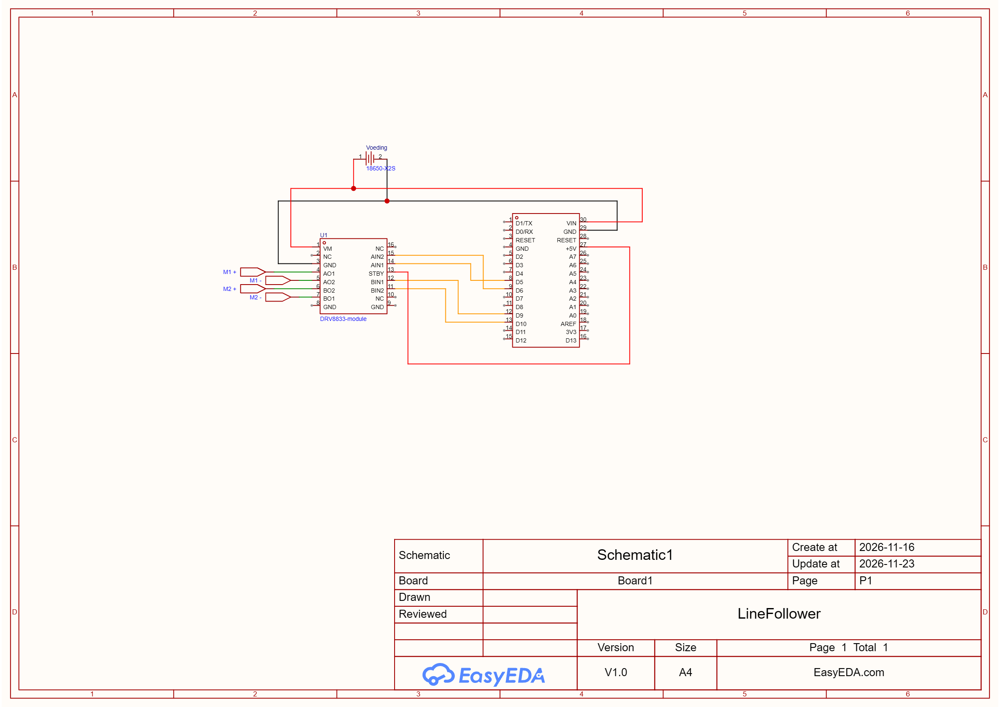

# H-Bridge proof of concept

minimale hard- & software + stappenplan dat aantoont dat 2 motoren onafhankelijk van elkaar kunnen draaien, en (traploos) regelbaar zijn in snelheid en draairichting.

**Functionaliteit**

Dit programma demonstreert de werking van de DRV8833-module met twee DC-motoren. Beide motoren versnellen geleidelijk tot hun maximale PWM-waarde (255) en vertragen daarna terug naar 0.

Vervolgens worden verschillende draairichtingen getest, zowel afzonderlijk als gelijktijdig. De ingestelde PWM-waarden en draairichtingen worden weergegeven in de Serial Monitor (9600 baud).

**Arduino code**

zie bestand [H-brug_test/H-brug_test.ino](H-brug_test/H-brug_test.ino)

**Benodigdheden**

- Arduino Nano V3
- DRV8833-module (H-brug)
- 2x N20-motor 6 V
- batterijhouder met 2x 18650 (7,4 V nominaal)
- dupont-draden

**Aansluitingen**

| DRV8833-module | aangesloten op | functie |
|---|---|---|
| AIN1 | Nano D5 (PWM) | motor A |
| AIN2 | Nano D6 (PWM) | motor A |
| BIN1 | Nano D9 (PWM) | motor B |
| BIN2 | Nano D10 (PWM) | motor B |
| STBY | Nano 5V | driver altijd actief |
| VM | batterij + (7,4 V) | motorvoeding |
| GND | batterij − en Nano GND | gemeenschappelijke massa |
| AO1 / AO2 | motor A + / − | |
| BO1 / BO2 | motor B + / − | |

| Nano | aangesloten op |
|---|---|
| VIN | batterij + (7,4 V) |
| GND | batterij − (gemeenschappelijke massa) |

> **STBY = nSLEEP:** de DRV8833-chip heeft een pin nSLEEP. Op de gebruikte module heet die pin STBY. Hoog (5 V) = driver actief, laag = slaapstand.

**Voeding**

De motoren worden rechtstreeks uit de batterij gevoed (batterij + naar VM van de DRV8833-module). De Nano krijgt dezelfde batterijspanning op VIN en maakt zelf 5 V via zijn regelaar. Batterij, DRV8833 en Nano hebben een gemeenschappelijke massa.

De motoren hangen dus **niet** aan de 5V-pin van de Nano: dan zou de motorstroom door de USB-poort of de regelaar van de Nano lopen, en bij het aanlopen of blokkeren van een motor kan de spanning zo ver zakken dat de Nano reset.

**Elektronisch schema**

EasyEDA Pro-bronbestand: [schema_hbrug.epro2](schema_hbrug.epro2) (openen via EasyEDA Pro → File → Open → EasyEDA Pro)

**Testresultaten**

In de serial monitor kan je het volledig volgen.

