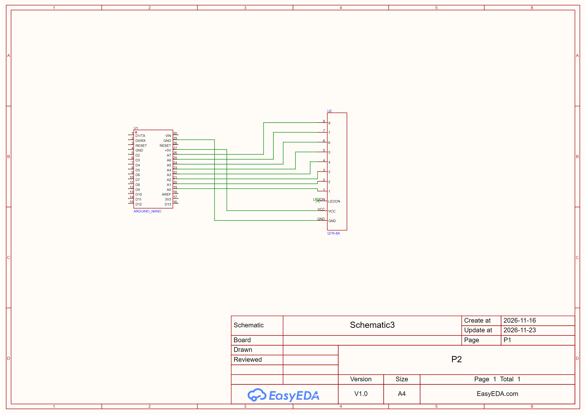

# Sensoren proof of concept

minimale hard- en software die aantoont dat minimaal 6 sensoren onafhankelijk van elkaar kunnen uitgelezen worden (geen calibratie, normalisatie of interpolatie). Hierbij moet een zo groot mogelijk bereik van de AD converter benut worden (indien van toepassing)

**Functionaliteit**

Dit programma leest de 8 sensoren van de QTR-8A afzonderlijk uit via de analoge ingangen A0 tot A7 van de Arduino Nano (10-bit ADC, 0–1023). Elke meting is het gemiddelde van 8 opeenvolgende metingen; de eerste meting wordt weggegooid zodat de ADC na het wisselen van kanaal stabiel is.

Bij de start volgt een kalibratie van 5 seconden: per sensor wordt de laagste (wit) en hoogste (zwart) waarde bijgehouden. Daarna wordt elke sensor omgerekend naar 0 (wit) tot 1000 (zwart), zodat het volledige bereik dat de sensor echt haalt benut wordt. Reageert een sensor nauwelijks (verschil < 100), dan meldt het programma dat in de Serial Monitor.

Uit de 8 waarden wordt ook de positie van de lijn berekend (gewogen gemiddelde): 0 = lijn onder sensor 1, 3500 = midden, 7000 = lijn onder sensor 8.

**Arduino code**

zie bestand [QTR-8A_Test/QTR-8A_Test.ino](QTR-8A_Test/QTR-8A_Test.ino)

**Benodigdheden**

- Arduino Nano V3
- QTR-8A reflectiesensor-array
- dupont-draden
- wit papier met een zwarte lijn (elektrische tape)

**Aansluitingen**

| QTR-8A | Arduino Nano |
|---|---|
| 1 | A0 |
| 2 | A1 |
| 3 | A2 |
| 4 | A3 |
| 5 | A4 |
| 6 | A5 |
| 7 | A6 |
| 8 | A7 |
| VCC | +5V |
| GND | GND |
| LEDON | niet aangesloten |

LEDON is op de QTR-8A intern opgetrokken: los gelaten zijn de IR-leds altijd aan. In het schema staat daarom een No Connect-vlag op LEDON.

**Elektronisch schema**



EasyEDA Pro-bronbestand: [schema_sensor.epro2](schema_sensor.epro2) (openen via EasyEDA Pro → File → Open → EasyEDA Pro)

**Stappenplan**

1. Sluit de QTR-8A aan op de Nano volgens de tabel hierboven.
2. Open `QTR-8A_Test.ino` in de Arduino IDE, kies bord Arduino Nano en de juiste poort, en upload.
3. Open de Serial Monitor op **115200 baud**.
4. Houd de sensor 2–3 mm boven het papier en beweeg hem tijdens de eerste 5 seconden over wit én zwart (kalibratie).
5. Beweeg de sensor daarna over de lijn en volg de waarden in de Serial Monitor.

Zet `PLOTTER` in de code op `true` om de 8 waarden als grafiek te zien in Tools → Serial Plotter.

**Testresultaten**

Per regel toont de Serial Monitor een balk met één teken per sensor (`.` wit, `o` / `O` / `#` steeds donkerder), de 8 waarden (0–1000) en de positie van de lijn. Voorbeeld met de lijn tussen sensor 4 en 5:

```
[...#O...]     0    0   12  910  640   20    0    0   positie: 3422
```

Elke sensor reageert afzonderlijk: alleen de sensoren boven de lijn lopen op naar 1000.
