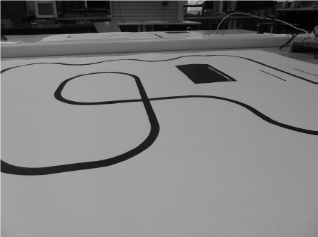

# LineFollower

lege repository die je als template kan gebruiken om een eigen repository te starten voor uw linefollower project

  
## specifications

microcontroller: NANO V3 Micro

motors: Micro Metal Gearmotor HPCB 6V

h-bridge: DRV8833

sensors: QTR-8A

batteries: 2x18650

wireless communication: HC-06

distance sensor - motors:

weight:

speed: 

