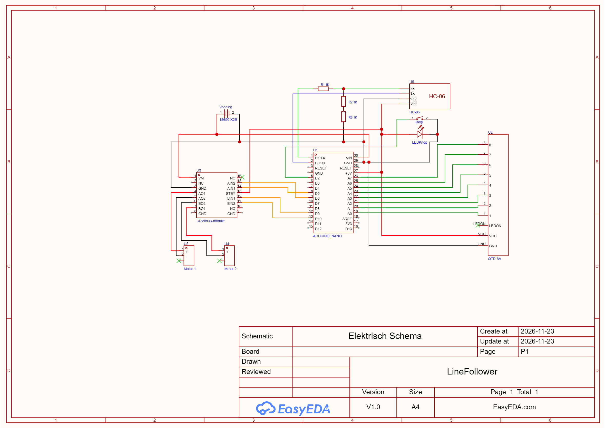

# Elektronisch schema

EasyEDA Pro-bronbestand: [schema_linefollower.epro2](schema_linefollower.epro2) (openen via EasyEDA Pro → File → Open → EasyEDA Pro)

## Aansluitingen

Het schema komt overeen met de schema's van de proofs of concept in `code/proof of concepts/`.

### Voeding

| van | naar |
|---|---|
| batterijhouder 2x18650 + (7,4 V) | VM van de DRV8833-module en VIN van de Nano |
| batterijhouder 2x18650 − | GND van alle onderdelen (gemeenschappelijke massa) |

- De **aan/uit-schakelaar** zit ingebouwd in de batterijhouder: hij onderbreekt de + van de batterij, zodat motoren en Nano samen uitgeschakeld worden. Daarom staat hij niet als apart onderdeel in het schema.
- De Nano maakt met zijn eigen regelaar 5 V uit VIN. Twee 18650-cellen geven 8,4 V (vol) tot ongeveer 6 V (leeg); de regelaar van de Nano heeft minstens ±7 V op VIN nodig. Laad de cellen dus op zodra de robot trager wordt of de Nano reset.
- De motoren worden rechtstreeks uit de batterij gevoed (VM), niet via de 5V van de Nano.
- De **+5V** van de Nano voedt de QTR-8A, de HC-06, STBY van de DRV8833-module en de led in de drukknop.
- Losse 18650-cellen worden opgeladen met een aparte 18650-lader.
- **Power-on-led:** de led in de metalen start/stop-drukknop (LEDKnop) hangt tussen +5V en GND en brandt zodra de schakelaar aan staat. Het is een 5V-led met ingebouwde weerstand, daarom staat er geen voorschakelweerstand in het schema.

### H-brug (DRV8833-module)

| DRV8833-module | aangesloten op |
|---|---|
| AIN1 / AIN2 | D5 / D6 |
| BIN1 / BIN2 | D9 / D10 |
| STBY (= nSLEEP van de chip) | +5V |
| AO1 / AO2 | motor 1 + / − |
| BO1 / BO2 | motor 2 + / − |

### Sensoren (QTR-8A)

| QTR-8A | Arduino Nano |
|---|---|
| 1 … 8 | A0 … A7 |
| VCC | +5V |
| GND | GND |
| LEDON | niet aangesloten (intern opgetrokken, IR-leds altijd aan) |

### Bluetooth (HC-06)

| HC-06 | Arduino Nano |
|---|---|
| TX | D0/RX |
| RX | D1/TX via spanningsdeler |
| VCC | +5V |
| GND | GND |

Spanningsdeler: D1/TX → R1 (1 kΩ) → RX van de HC-06, en vanaf dat knooppunt R2 + R3 (2× 1 kΩ) naar GND. Zo krijgt de RX ongeveer 3,3 V in plaats van 5 V. Koppel de HC-06 los tijdens het uploaden (D0/D1 delen de USB-verbinding).

### Start/stop-knop met led

Metalen drukknop (monostabiel) met ingebouwde led. In het schema staan de schakelaar (Knop) en de led (LEDKnop) als twee aparte symbolen.

| onderdeel | aansluiting |
|---|---|
| Knop pin 1 (C) | D2 (interrupt-pin INT0) |
| Knop pin 2 (NO) | GND |
| LEDKnop + (anode) | +5V |
| LEDKnop − (kathode) | GND |

Geen externe weerstand voor de knop: D2 gebruikt de interne pull-up (`INPUT_PULLUP`). Ook de led heeft geen externe weerstand nodig (5V-versie met interne weerstand).
