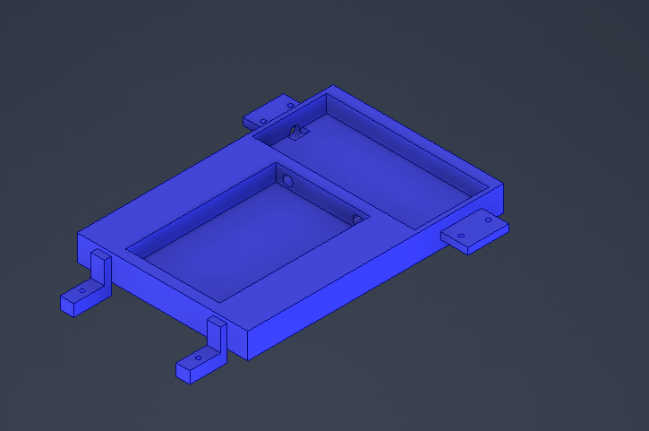
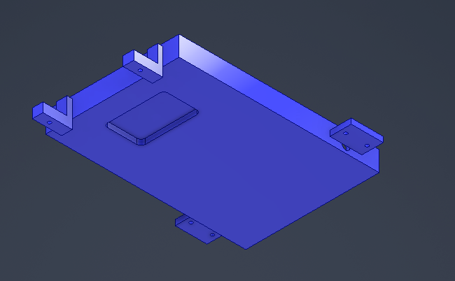

# Mechanische tekening

3D-printbaar frame voor de line follower, getekend in Autodesk Inventor.

**Bronbestand:** [frame.ipt](frame.ipt) (Autodesk Inventor)

| bovenkant | onderkant |
|---|---|
|  |  |

Het frame bestaat uit één stuk met:

- twee vakken aan de bovenkant: één voor de batterijhouder (2x 18650) en één voor de elektronica (Arduino Nano, DRV8833-module, HC-06 op een prototype-printplaat);
- bevestigingspunten aan de zijkanten en onderkant voor de motorbeugels, de QTR-8A en het hulpwiel.

Alle maten staan in het Inventor-bestand. De robot moet onder de chronobrug passen: binnenmaten 12 cm breed x 12 cm hoog.
